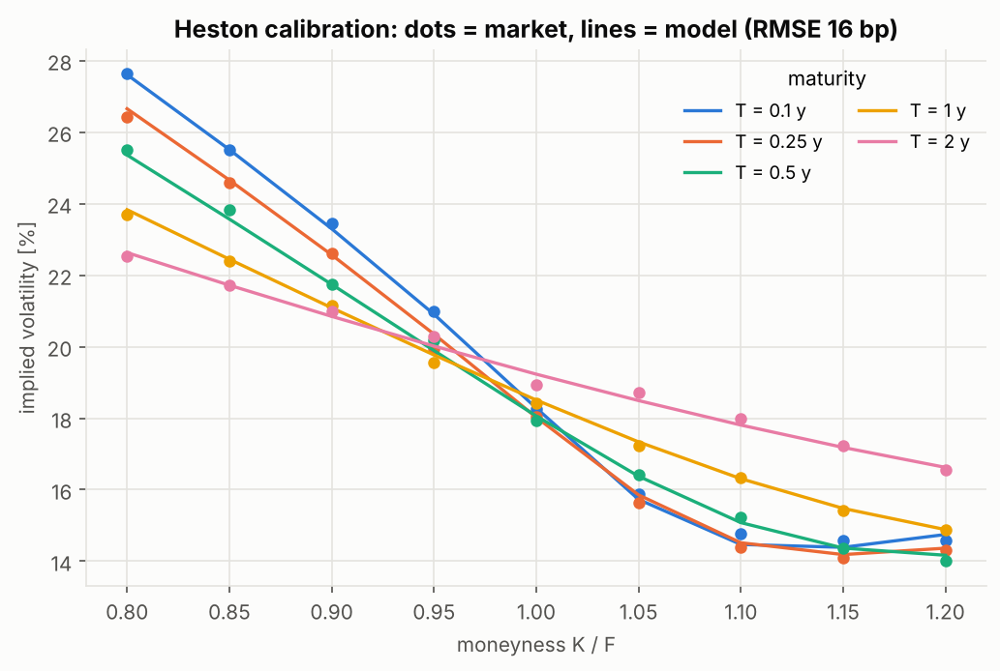
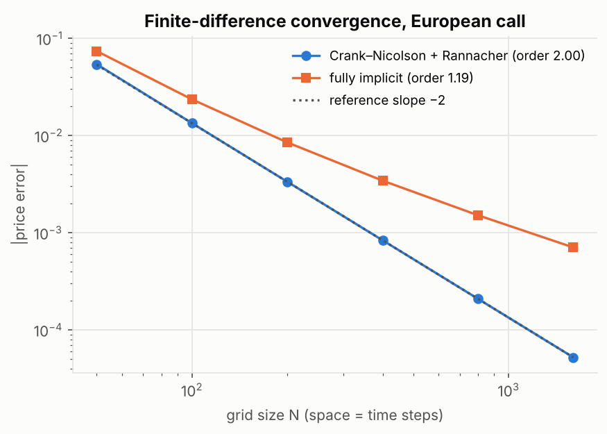
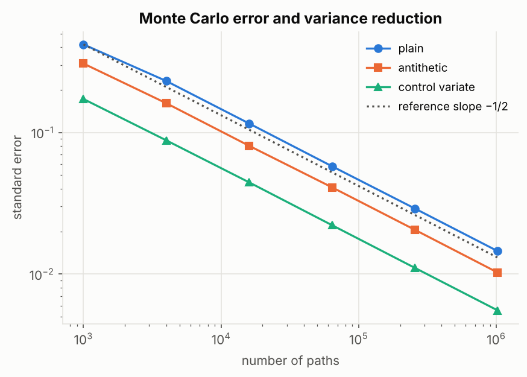
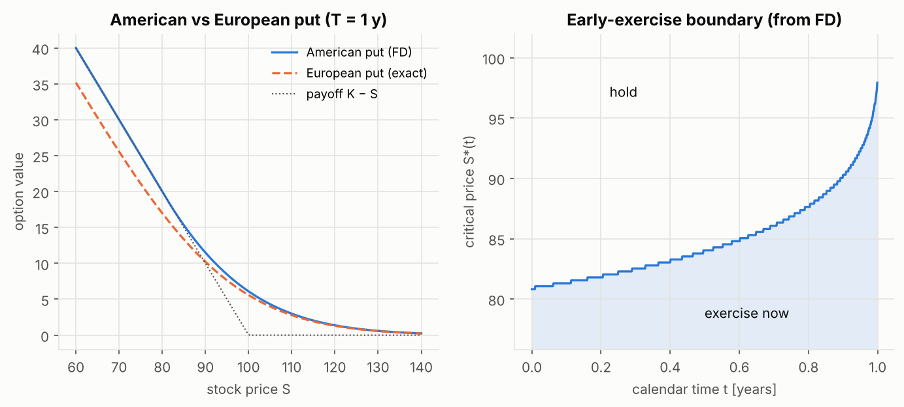
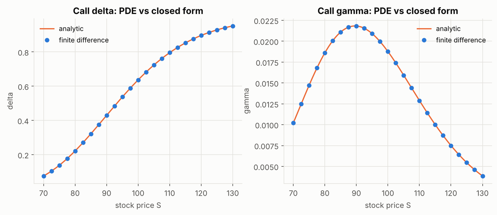
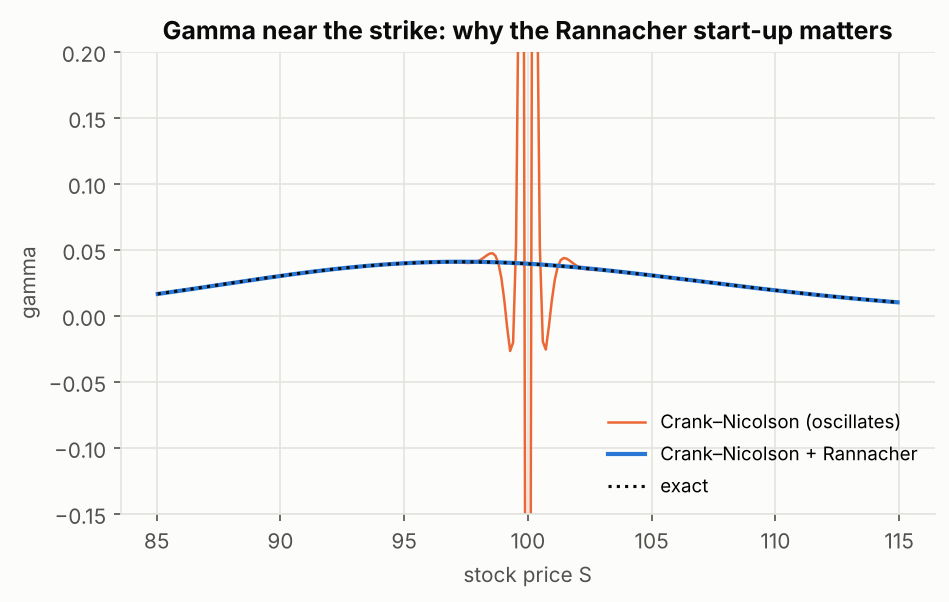

# Option Pricing Three Ways: Closed Form, PDE and Monte Carlo

Price European and American options with three independent methods, measure how
fast each converges and how long it takes, and calibrate the Heston
stochastic-volatility model to a volatility smile.



## Results at a glance

Test case: $S_0 = K = 100$, $T = 1$ year, $r = 5\%$, $\sigma = 20\%$.

| Method | European call | Error vs exact | Runtime |
|---|---|---|---|
| Black–Scholes formula | 10.45058 | (reference) | µs |
| Crank–Nicolson PDE, 400×400 grid | 10.44975 | 8.4 × 10⁻⁴ | 0.02 s |
| Monte Carlo, 1M paths + control variate | 10.45063 ± 0.0056 (1 s.e.) | 5 × 10⁻⁵ | 0.05 s |

| American put | Price | Difference vs tree |
|---|---|---|
| Binomial tree, 5,000 steps (reference) | 6.0902 | (reference) |
| Crank–Nicolson + Brennan–Schwartz, 800×800 | 6.0900 | −0.0002 |
| Longstaff–Schwartz MC, 200k paths, 100 dates | 6.0962 ± 0.0094 | +0.006 (within 1 s.e.) |
| *European put (exact), for comparison* | *5.5735* | early-exercise premium **0.52** |

Other findings:

- **Convergence order:** Crank–Nicolson + Rannacher **2.00** (theory: 2), fully implicit **1.19** (theory: 1 in time).
- **Variance reduction:** the control variate cuts the variance by **6.9×**, antithetic sampling by **2.0×**.
  That's 6.9× fewer paths for the same accuracy.
- **Greeks from the PDE grid:** max error vs closed form 5 × 10⁻⁵ (delta), 3 × 10⁻⁶ (gamma).
- **Rannacher start-up:** without it, Crank–Nicolson gives **gamma = −4.53** at the strike (exact: 0.039). With it: 0.0394.
- **Heston calibration** to 45 quotes over 5 maturities: implied-vol RMSE **16 bp** (the quotes carry 20 bp noise,
  so the fit is at the noise level), all 5 parameters recovered within 7 %, 0.4 s.

All numbers are produced by `python scripts/run_all.py` and saved to `results/benchmark.json`.

## The mathematics

Under the risk-neutral measure, $dS = (r-q)S\,dt + \sigma S\,dW$, and an option value $V(S,t)$ solves the
**Black–Scholes PDE**

$$ \frac{\partial V}{\partial t} + \tfrac12\sigma^2 S^2 \frac{\partial^2 V}{\partial S^2} + (r-q) S \frac{\partial V}{\partial S} - rV = 0, \qquad V(S,T) = \text{payoff}(S). $$

### 1. Finite differences (`finite_difference.py`)
- Substituting $x = \ln S$, $\tau = T - t$ gives a PDE with **constant coefficients**:
  $V_\tau = \tfrac12\sigma^2 V_{xx} + (r - q - \tfrac12\sigma^2)V_x - rV$.
- Central differences in space, **θ-scheme** in time (θ = ½: Crank–Nicolson, second order).
  Each step is one tridiagonal solve, O(N).
- **Rannacher start-up:** the payoff kink makes Crank–Nicolson ring (see figure below). Four fully
  implicit steps at the start damp it and keep second-order convergence.
- **American options** are a free-boundary problem, $V \ge \text{payoff}$. Each time step becomes a
  linear complementarity problem, solved exactly with the **Brennan–Schwartz** algorithm. The
  early-exercise boundary $S^*(t)$ falls out of the solution.

### 2. Monte Carlo (`monte_carlo.py`)
- Exact GBM sampling $S_T = S_0 e^{(r-q-\sigma^2/2)T + \sigma\sqrt{T}Z}$, so no time-discretization bias.
- Error $\propto 1/\sqrt{n}$, independent of dimension. Two variance-reduction techniques:
  **antithetic variates** and a **control variate** ($e^{-rT}S_T$, whose mean $S_0e^{-qT}$ is known).
- **Longstaff–Schwartz** for American options: walk backwards, regress continuation values on
  polynomials of $S$ (in-the-money paths only), exercise where the payoff is larger.

### 3. Heston model (`heston.py`)

$$ dS = (r-q)S\,dt + \sqrt{v}\,S\,dW_1, \qquad dv = \kappa(\theta - v)\,dt + \xi\sqrt{v}\,dW_2, \qquad d\langle W_1, W_2\rangle = \rho\,dt $$

- Semi-closed-form prices by **Fourier inversion** of the characteristic function, using the
  numerically stable "little Heston trap" formulation and 256-point Gauss–Legendre quadrature,
  vectorized over strikes.
- **Calibration:** bounded nonlinear least squares on vega-weighted price errors (≈ implied-vol
  errors, without inverting Black–Scholes inside the optimizer loop).

## Figures

| | |
|---|---|
|  |  |
|  |  |
|  | |

## Discussion

- **When to use which method:** PDEs win in 1–2 dimensions (fast, accurate Greeks, American exercise);
  Monte Carlo wins for many underlyings or path dependence, where grids explode; closed forms are for
  validation and calibration.
- **Convergence order is a correctness test.** Measuring a slope of 2.00 confirms that the scheme is implemented
  correctly, not just that one price looks plausible.
- **LSM is biased low by construction** (a sub-optimal exercise rule, and only 100 exercise dates instead of
  continuous exercise). Here that bias is smaller than the Monte Carlo noise.
- **Heston parameters are partly confounded.** κ and θ trade off against each other (κ is off by 7 %, θ by 1 %),
  a well-known identifiability issue. The fitted parameters violate the Feller condition, as is typical for
  equity markets with strong skew.

## Run it

```bash
python -m venv .venv && source .venv/bin/activate     # Windows: .venv\Scripts\activate
pip install -r requirements.txt
python scripts/run_all.py        # figures/ and results/benchmark.json
pytest                           # 16 tests
```

### Calibrate to real market quotes

Export an option chain (e.g. from your broker, or `yfinance`) to a CSV with columns
`K, T, bid, ask, kind` (`T` in years, `kind` = `call`/`put`), then:

```bash
python scripts/run_all.py --chain data/spx_chain.csv --spot 5800 --rate 0.04
```

The loader uses mid prices, drops illiquid quotes, keeps out-of-the-money options only, and weights
quotes with tight bid–ask spreads more heavily.

### Use as a library

```python
from optpricing import black_scholes as bs, price_fd, price_european_mc, heston

bs.price(100, 100, 1, 0.05, 0.2, kind="call")
price_fd(100, 100, 1, 0.05, 0.2, kind="put", american=True).price
price_european_mc(100, 100, 1, 0.05, 0.2, n_paths=10**6, method="control").ci95
```

## Project structure

```
src/optpricing/
  black_scholes.py      closed-form prices, Greeks, implied volatility
  finite_difference.py  θ-scheme / Crank–Nicolson with Rannacher, Brennan–Schwartz for American options
  monte_carlo.py        MC with variance reduction, Longstaff–Schwartz, binomial tree
  heston.py             characteristic function, Fourier pricing, calibration, data loaders
scripts/run_all.py      all experiments and figures
tests/                  16 tests (known values, parity, convergence order, calibration recovery)
```

## References

- J. Hull, *Options, Futures, and Other Derivatives*, Pearson.
- D. Tavella, C. Randall, *Pricing Financial Instruments: The Finite Difference Method*, Wiley, 2000.
- F. Longstaff, E. Schwartz, "Valuing American options by simulation", *Review of Financial Studies*, 2001.
- S. Heston, "A closed-form solution for options with stochastic volatility", *Review of Financial Studies*, 1993.
- H. Albrecher et al., "The little Heston trap", *Wilmott Magazine*, 2007.
